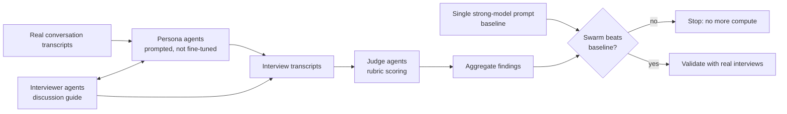
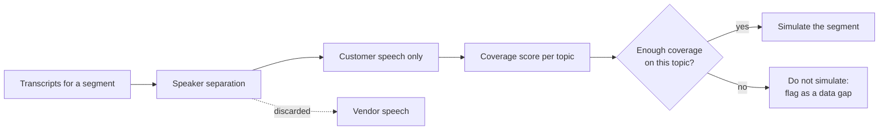
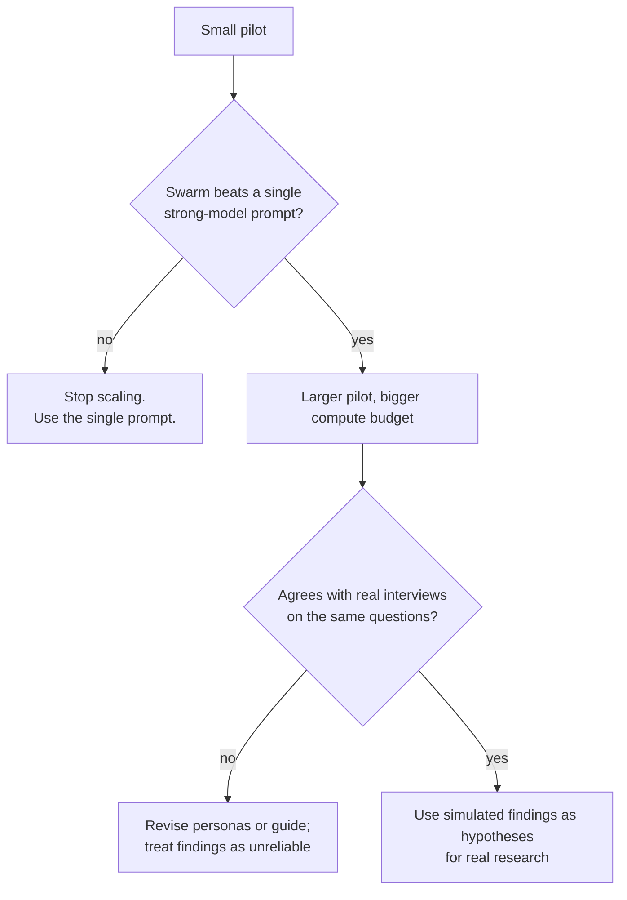
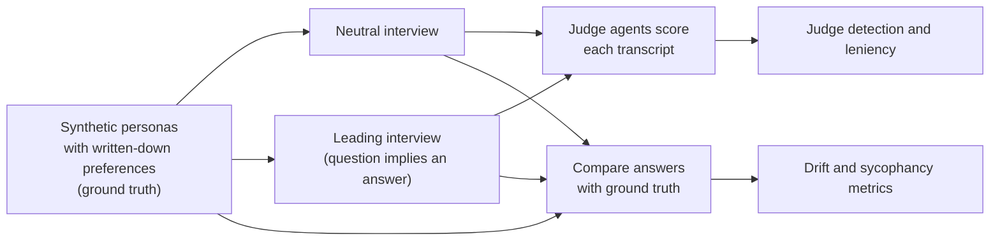

# Persona swarms for evaluation research: an approach note

*Do simulated users tell you what you want to hear?*

This note describes an approach I designed and piloted for **simulation-based evaluation research**: a swarm of LLM agents that plays customers, interviews them, and judges the answers, so that research which normally takes weeks of interviews can be explored in hours. It covers the design, the safeguards I found necessary, and the open safety questions, chiefly **sycophancy**, that decide whether such a swarm produces signal or just agreement.

It is an approach note, not a results paper. The pilot ran on proprietary data, so no data, outputs or identifying details are published here. Everything below is method and lessons.

## Design idea: compute-scaled simulation

The approach borrows its shape from computational fluid dynamics. The Navier-Stokes equations are rarely solved analytically; instead, compute is thrown at a numerical simulation and the behaviour of the flow emerges from many small interactions. A persona swarm does the same for a research question: rather than reasoning about customers in the abstract, scaled groups of agents are directed at the problem, and the answer emerges from many simulated conversations. The shape is domain-agnostic. The pilot targeted product research for evaluation features, but the same structure (personas from real conversations, interviewers, judges, a baseline and a validation step) carries over to other industries unchanged.

---

## Why this matters for AI safety

Evaluations are increasingly run by models: models simulate users, models grade outputs, models decide what "good" looks like. A persona swarm is a compact version of that stack, and it fails in the ways scalable oversight worries about:

- **Sycophantic subjects.** A simulated user may drift toward whatever the interviewer implies, so a leading question "confirms" the hypothesis it carried.
- **Lenient judges.** An LLM judge may reward agreement, fluency or length rather than fidelity to the persona.
- **Self-preference.** Judges and personas built on the same model family may grade each other favourably.
- **False confidence from scale.** Hundreds of agents agreeing looks like evidence. It may be one model's prior, repeated.

If simulated research is going to inform real decisions, these failure modes need to be measured, not assumed away.

## Architecture

**Figure 1. Architecture.**

- **Persona agents** are *prompted* with real conversation transcripts from one account or segment. Nothing is fine-tuned: the persona is the transcript in context plus a role instruction.
- **Interviewer agents** run a discussion guide against the personas.
- **Judge agents** score each interview against a rubric and extract candidate findings.
- **Coverage analysis** comes first: before simulating a segment, score whether there is enough transcript material to represent it, and visualise coverage per segment (radar charts and heat maps), so that thinly covered segments are not simulated from almost nothing.

**Table 1. Roles in the swarm.**

| Role | Input | Output | Design choice |
|---|---|---|---|
| Persona agent | One account's or segment's transcripts in context, plus a role instruction | Answers in that customer's voice | Prompted, never fine-tuned, so personas can be rebuilt from new transcripts at no training cost |
| Interviewer agent | A discussion guide | Questions and follow-ups | Same guide across personas, so differences come from the persona, not the interviewer |
| Judge agent | An interview transcript and a rubric | Scores and candidate findings | Kept separate from the interviewer, so no agent grades its own questions |
| Single-prompt baseline | The same question, asked once of a strong model with the same transcripts | One answer | The bar the swarm has to beat |

**Figure 2. Coverage check before simulating a segment.**

## Safeguards that turned out to be necessary

1. **Score the subject's speech only.** Transcripts contain both sides of a conversation. Coverage scoring initially counted the vendor's own speech as evidence about the customer, which inflated coverage. Scoring now counts customer speech only. The same contamination can leak into personas: a persona built from a transcript can learn to sound like the interviewer.
2. **Beat a single-prompt baseline before scaling.** The baseline is one strong-model prompt given the same source material, about 30,000 words of transcripts. A blind comparison showed that this single prompt could match the swarm on a simple question. So the rule became: the next, larger pilot must outperform a single strong prompt before any more compute is spent. Many agents are not automatically more signal than one good prompt.
3. **Stage the compute.** A small pilot budget, then a larger pool only after the baseline gate. Multi-agent runs are expensive and can exceed standard account limits; open-weight models are the obvious way to cut cost per run.
4. **Validate against reality.** Simulated findings are treated as hypotheses, never as conclusions, until real interviews confirm them. In the pilot, the swarm's findings were compared against a separate set of real customer interviews, which validated them. A statistical method for comparing simulated and real responses is part of the design; a colleague owns that part.
5. **Seek invalidation, not validation.** Discussion guides must give the persona every chance to say the hypothesis is wrong, and must ask what is must-have versus deferrable. A guide that only lets a persona agree is measuring the guide.

**Figure 3. Compute gate.** More agents cost more and are not automatically more signal, so every scale-up has to earn its compute.

**Table 2. Failure modes and what guards against them.**

| Failure mode | How it shows up | Safeguard | How to measure it |
|---|---|---|---|
| Sycophantic persona | Persona agrees with whatever the question implies | Neutral discussion guides; seek invalidation | Drift rate under leading vs neutral questions (Table 3) |
| Lenient judge | Agreeable or fluent answers score higher than faithful ones | Rubric scores fidelity to the persona, not helpfulness | Judge leniency (Table 3) |
| Self-preference | Same model family as persona and judge grades its own style favourably | Different families per role | Leniency with same-family vs cross-family judges |
| Vendor-speech contamination | Persona echoes the interviewer's or vendor's language | Score and simulate from customer speech only | Share of persona answers that reuse vendor phrasing |
| Thin data | Persona invents preferences for a segment with little transcript material | Coverage check before simulating (Figure 2) | Coverage score per segment and topic |
| False confidence from scale | Many agents agreeing reads as strong evidence | Single-prompt baseline gate (Figure 3) | Swarm vs baseline on held-out questions |

## Open questions (the experiments I want to run)

- **Persona sycophancy under leading questions.** Give personas written-down ground-truth preferences, then ask the same questions in neutral and leading form. How often do they abandon their stated preferences, and does this vary by model and persona-prompt design?
- **Judge reliability.** Do LLM judges flag that drift, or score agreeable answers higher? How well do judge scores agree with human ratings of persona fidelity?
- **When does a swarm beat one prompt?** Characterise the questions (open-ended, multi-segment, contrarian) where diversity across many agents adds real signal over a single high-reasoning prompt.
- **Cross-family checks.** Does using different model families for personas, interviewers and judges reduce self-preference effects?

### Proposed experiment: persona sycophancy and judge reliability

**Figure 4. Design.**

**Table 3. Metrics.**

| Metric | Definition | What a good result looks like |
|---|---|---|
| Drift rate | Share of ground-truth preferences a persona contradicts in an interview | Low in neutral interviews |
| Sycophancy delta | Drift rate under leading questions minus drift rate under neutral questions | Close to zero |
| Judge detection rate | Share of drifted answers the judge flags as unfaithful to the persona | High |
| Judge leniency | Mean judge score for drifted-but-agreeable answers minus mean score for faithful answers | Zero or negative |
| Swarm advantage | Agreement with ground truth of the swarm's aggregate answer minus that of a single strong prompt | Positive on hard, open-ended questions |

**Table 4. Factors to vary.**

| Factor | Levels |
|---|---|
| Question framing | Neutral, mildly leading, strongly leading |
| Persona model family | 2 to 3 open-weight families |
| Judge model family | Same as persona, different from persona |
| Persona prompt design | Transcript only; transcript plus explicit "you may disagree" instruction |
| Swarm size | 1 (baseline), 10, 50 personas per segment |

## Status

Ongoing. Approach note written October 2026. The pilot's findings were validated against real customer interviews; the pilot ran on proprietary data that cannot be shared, so its outputs are not published here; the experiments above are designed to run on synthetic personas with fixed ground truth, so they can be published in full.

## Author

Approach designed and piloted by Elias Chawki, with a colleague contributing the statistical comparison method.

Elias Chawki · [linkedin.com/in/eliasc](https://linkedin.com/in/eliasc)

License: MIT
