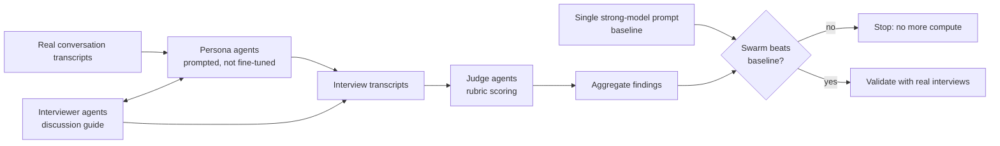

# Persona swarms for evaluation research: an approach note

*Do simulated users tell you what you want to hear?*

This note describes an approach I designed and piloted for **simulation-based evaluation research**: a swarm of LLM agents that plays customers, interviews them, and judges the answers, so that research which normally takes weeks of interviews can be explored in hours. It covers the design, the safeguards I found necessary, and the open safety questions, chiefly **sycophancy**, that decide whether such a swarm produces signal or just agreement.

It is an approach note, not a results paper. The pilot ran on proprietary data, so no data, outputs or identifying details are published here. Everything below is method and lessons.

---

## Why this matters for AI safety

Evaluations are increasingly run by models: models simulate users, models grade outputs, models decide what "good" looks like. A persona swarm is a compact version of that stack, and it fails in the ways scalable oversight worries about:

- **Sycophantic subjects.** A simulated user may drift toward whatever the interviewer implies, so a leading question "confirms" the hypothesis it carried.
- **Lenient judges.** An LLM judge may reward agreement, fluency or length rather than fidelity to the persona.
- **Self-preference.** Judges and personas built on the same model family may grade each other favourably.
- **False confidence from scale.** Hundreds of agents agreeing looks like evidence. It may be one model's prior, repeated.

If simulated research is going to inform real decisions, these failure modes need to be measured, not assumed away.

## Architecture

- **Persona agents** are *prompted* with real conversation transcripts from one account or segment. Nothing is fine-tuned: the persona is the transcript in context plus a role instruction.
- **Interviewer agents** run a discussion guide against the personas.
- **Judge agents** score each interview against a rubric and extract candidate findings.
- **Coverage analysis** comes first: before simulating a segment, score whether there is enough transcript material to represent it, and visualise coverage per segment (radar charts and heat maps), so that thinly covered segments are not simulated from almost nothing.

## Safeguards that turned out to be necessary

1. **Score the subject's speech only.** Transcripts contain both sides of a conversation. Coverage scoring initially counted the vendor's own speech as evidence about the customer, which inflated coverage. Scoring now counts customer speech only. The same contamination can leak into personas: a persona built from a transcript can learn to sound like the interviewer.
2. **Beat a single-prompt baseline before scaling.** A blind comparison showed that one strong-model prompt could match the swarm on a simple question. So the rule became: the next, larger pilot must outperform a single strong prompt before any more compute is spent. Many agents are not automatically more signal than one good prompt.
3. **Stage the compute.** A small pilot budget, then a larger pool only after the baseline gate. Multi-agent runs are expensive and can exceed standard account limits; open-weight models are the obvious way to cut cost per run.
4. **Validate against reality.** Simulated findings are treated as hypotheses for real interviews, never as conclusions. A statistical method for comparing simulated and real responses is part of the design; a colleague owns that part.
5. **Seek invalidation, not validation.** Discussion guides must give the persona every chance to say the hypothesis is wrong, and must ask what is must-have versus deferrable. A guide that only lets a persona agree is measuring the guide.

## Open questions (the experiments I want to run)

- **Persona sycophancy under leading questions.** Give personas written-down ground-truth preferences, then ask the same questions in neutral and leading form. How often do they abandon their stated preferences, and does this vary by model and persona-prompt design?
- **Judge reliability.** Do LLM judges flag that drift, or score agreeable answers higher? How well do judge scores agree with human ratings of persona fidelity?
- **When does a swarm beat one prompt?** Characterise the questions (open-ended, multi-segment, contrarian) where diversity across many agents adds real signal over a single high-reasoning prompt.
- **Cross-family checks.** Does using different model families for personas, interviewers and judges reduce self-preference effects?

## Status

Ongoing. Approach note written October 2026. The pilot ran on proprietary data that cannot be shared; the experiments above are designed to run on synthetic personas with fixed ground truth, so they can be published in full.

## Author

Approach designed and piloted by Elias Chawki, with a colleague contributing the statistical comparison method.

Elias Chawki · [linkedin.com/in/eliasc](https://linkedin.com/in/eliasc)

License: MIT
